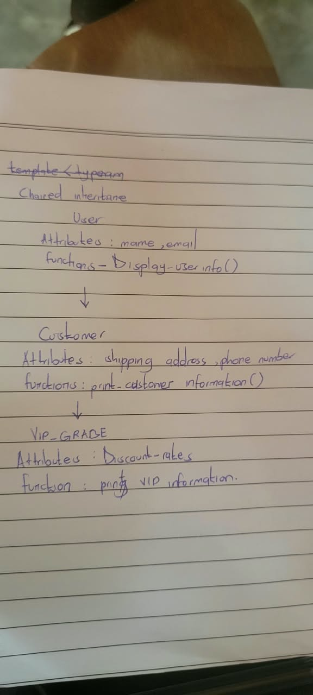

# Chained Inheritance Example

This C++ program demonstrates **multilevel (chained) inheritance** in the context of a Ugandan shop's customer records. `Customer` inherits from `User`, and `VIP_GRADE1` inherits from `Customer`. A VIP customer can therefore use information and functions inherited through both parent classes.

For a local shop, customer records might include an address in Kampala, Entebbe, or Jinja and a phone number with Uganda's `+256` country code. A VIP discount could be applied to a price listed in Ugandan shillings (UGX); this example prints the discount percentage but does not calculate a price.

## Class hierarchy



The diagram represents this inheritance chain:

```text
User
  └── Customer
        └── VIP_GRADE1
```

## What each class contains

- **`User`** stores a user's `name` and `email`. Its `print_user_information()` function displays those fields.
- **`Customer`** extends `User` with a `shipping_address` and `phone_number`. Its `print_customer_information()` function prints the inherited user details and the customer details.
- **`VIP_GRADE1`** extends `Customer` with a `Discount_rate`. Its `print_VIP_information()` function prints all inherited information and the applied discount percentage.

The members `name` and `email` are `protected`, allowing derived classes to access them while preventing direct access from `main()`. Each constructor initializes its own fields and passes inherited values to its base-class constructor.

## Expected output

```text
Name: Alice Wonderland
Email: alicewonder@gmail.com
Name: Alice Wonderland
Email: alicewonder@gmail.com
Shipping address: Old PortBell Road, plot 67
Phone number: +256774378008
Name: Lucky Dube
Email: luckydu@outlook.com
Shipping address: Jamiaca Wild Street, plot 89
Phone number: +1 (856) 555-0744
Applied discount rate: 18.95%
```

See the implementation in [`inheritance.cpp`](./inheritance.cpp).