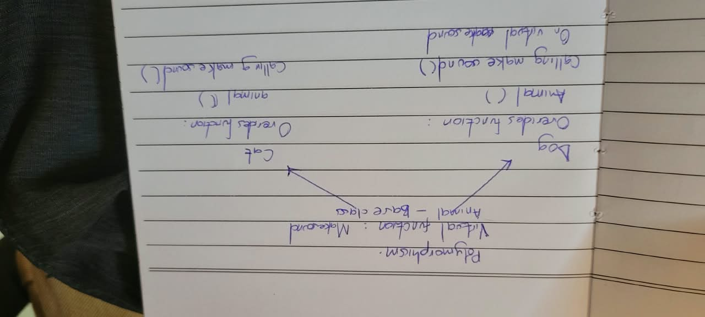

# Animal Polymorphism Example

This example demonstrates **runtime polymorphism** in C++. A base-class pointer can refer to an object of a derived class, and calling a virtual function through that pointer runs the derived class's override.

## Related image



*Handwritten diagram illustrating the `Animal` base class and the `Dog` and `Cat` subclasses.*

## How the code works

- `Animal` is the base class. Its `makeSound()` method is marked `virtual`.
- `Dog` and `Cat` inherit from `Animal` and each override `makeSound()`.
- In `main()`, `Animal*` pointers refer to a `Dog` and a `Cat`.
- Calling `makeSound()` through those pointers dispatches to the appropriate derived-class implementation.
- The virtual destructor allows derived objects to be safely deleted through base-class pointers.

## Expected output

```text
Buddy says: Woof!
Whiskers says: Meow!
```

See the source code in [`polymorphismassignment.cpp`](./polymorphismassignment.cpp).
